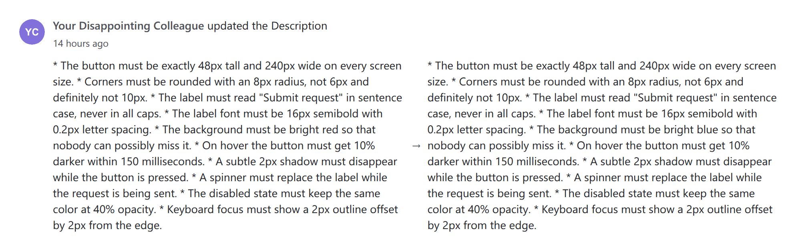
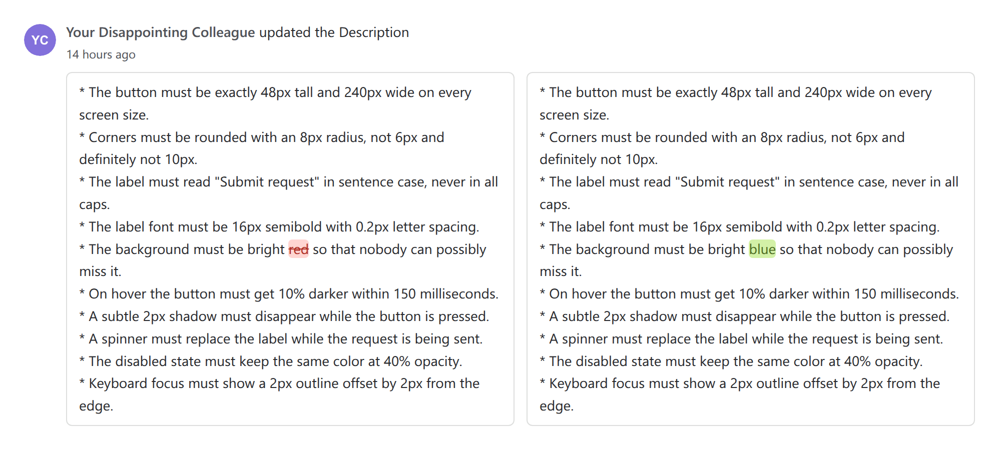

# Jira History Diff

Browser extension that shows word-level, side-by-side diffs for text field changes in the History tab of Jira Cloud (`*.atlassian.net`) issues. Removed words are highlighted in red, added words in green; the colors follow Jira's light and dark themes.

Fork of [Jira History Diff](https://addons.mozilla.org/firefox/addon/jira-history-diff/) 1.0.0 by Prashant Yadav, MIT licensed.

## Screenshots

Jira's own view of a changed description:

<picture>
  <source media="(prefers-color-scheme: dark)" srcset="docs/before-dark.png">
  
</picture>

The same history item with the extension:

<picture>
  <source media="(prefers-color-scheme: dark)" srcset="docs/after-dark.png">
  
</picture>

## What it does

- Replaces the "old → new" value row of a history item with two panes, keeping the author, field name and time visible.
- Works with any UI language: history items are found by Jira's `data-testid` and DOM structure, not by text.
- Preserves line breaks of multi-line values.
- Leaves Jira's own view when the values have no words in common (`None → value`, picklist switches) or are too large to diff.
- Runs entirely in the page: no network requests, no data collection. The only setting is an on/off switch stored in `storage.sync`.

## Install for development

Chrome / Chromium: open `chrome://extensions`, enable Developer mode, click **Load unpacked** and select this directory.

Firefox: open `about:debugging#/runtime/this-firefox`, click **Load Temporary Add-on…** and select `manifest.json`.

## Files

| File | Purpose |
| --- | --- |
| `manifest.json` | Shared MV3 manifest for Chrome and Firefox |
| `content.js` | Finds history items, extracts values, renders diff panels |
| `word-diff.js` | Word-level diff: tokenizer, LCS, merging of adjacent changes |
| `styles.css` | Panel styles based on Atlassian design tokens |
| `popup.html`, `popup.js` | On/off switch |
| `test/` | Unit tests for `word-diff.js` |

## Tests

```sh
node --test test/
```

## Limitations

- Jira Server / Data Center is not supported.
- Rich text values are compared as plain text.
- Very large changes (roughly a thousand changed words on each side) are not diffed.
